# Orac Chess relational schema

The `orac_chess` plugin owns these objects in the dedicated `ORAC_CHESS` Oracle schema. The initial release defined storage; the 0.2.0 administration extension adds controlled APIs and APEX maintenance (see [administration](administration.md)). PGN remains authoritative for moves. These are fresh-install assets for the initial non-production schema. Existing deployment contexts and labels are retained; they do not authorise production execution.

## Table and column inventory

**Source amendment — 01-Nov-2026:** The user authorised adding `OPENING_TYPE`
to the original `CHESS_OPENING` CREATE TABLE. The fresh-install baseline now has
161 SQL changesets, including `CHS_OPN_TYPE_CK`. This edit changes executed source
checksums and cannot upgrade the former 160-changeset installation. No checksum
reset or forward migration is supplied. Historical installation and verification
records below describe the earlier baseline.
Source validation for this amendment passed all 77 tests in
`tests.test_orac_chess_schema`, `tests.test_plugin_database_deployment` and
`tests.test_plugin_database_session`, plus Ruff and Black for the Chess test
module.

**Managed reinstall verification — 01-Nov-2026:** Following the user's reinstall
instruction, all 20 business tables were confirmed empty and no ORAC_CHESS sessions
were active. The removal dry run verified the owned schema and development target
FREEPDB1 (PDB DBID 1952816188, GUID 5D043F5CC19F0B05E063040014AC37BB).
Managed removal and installation from `plugins/orac_chess` succeeded, preserving
historical Core knowledge. All 161 changesets were EXECUTED; managed readiness,
`verify_structure.sql`, `verify_constraints.sql` and `diagnose_hierarchies.sql`
passed on Oracle AI Database 26ai Free 23.26.0.0.0. Opening classification defaults,
permitted values, invalid/null rejection and relationship-preserving
reclassification passed. Temporary rows were rolled back, CHESS_OPENING remained
empty, and no invalid objects or hierarchy defects were reported.

The Nullable column uses `N` for `NOT NULL` and `Y` for nullable. Identity keys are `GENERATED BY DEFAULT ON NULL AS IDENTITY`.

### `chess_opening`

Recognised opening identity and its optional parent in an opening family.

`opening_type` classifies the identity as `OPENING` (the default) or `SYSTEM`.
Both use the existing opening relationships, aliases, hierarchy, ECO mappings,
gambit links, variations, games, commentary and media/concept associations.
Changing classification preserves `opening_id` and all those links. Opening
variation ownership remains `O`, including for systems; it is separate from this
classification. Names remain unique across both classifications.

| Column | Oracle definition | Nullable |
| --- | --- | --- |
| `opening_id` | `number generated by default on null as identity not null` | N |
| `name` | `varchar2(200 char) not null` | N |
| `opening_type` | `varchar2(20 char) default 'OPENING' not null` | N |
| `description` | `clob` | Y |
| `parent_opening_id` | `number` | Y |

**Primary key:** `opening_id`.

### `chess_opening_alias`

Alternative recognised names for one opening.

| Column | Oracle definition | Nullable |
| --- | --- | --- |
| `opening_alias_id` | `number generated by default on null as identity not null` | N |
| `opening_id` | `number not null` | N |
| `alias_name` | `varchar2(200 char) not null` | N |

**Primary key:** `opening_alias_id`.

### `chess_gambit`

Named gambit identity, independent of the openings that contain it.

| Column | Oracle definition | Nullable |
| --- | --- | --- |
| `gambit_id` | `number generated by default on null as identity not null` | N |
| `name` | `varchar2(200 char) not null` | N |
| `description` | `clob` | Y |

**Primary key:** `gambit_id`.

### `chess_opening_gambit`

Many-to-many classification of gambits within openings.

| Column | Oracle definition | Nullable |
| --- | --- | --- |
| `opening_id` | `number not null` | N |
| `gambit_id` | `number not null` | N |

**Primary key:** `opening_id`, `gambit_id`.

### `chess_opening_eco`

Zero or more ECO classifications per opening; a code may classify multiple openings.
No code is designated primary or representative.

| Column | Oracle definition | Nullable |
| --- | --- | --- |
| `opening_id` | `number not null` | N |
| `eco_code` | `varchar2(3 char) not null` | N |

**Primary key:** `opening_id`, `eco_code`.

### `chess_variation`

Named complete PGN lines for one opening or gambit, including branches.

| Column | Oracle definition | Nullable |
| --- | --- | --- |
| `variation_id` | `number generated by default on null as identity not null` | N |
| `opening_id` | `number` | Y |
| `gambit_id` | `number` | Y |
| `variation_type` | `generated always as (cast(case when opening_id is not null then 'O' when gambit_id is not null then 'G' end as varchar2(1 char))) virtual` | Derived; owner check requires O/G |
| `parent_variation_id` | `number` | Y |
| `branch_ply` | `number(5)` | Y |
| `name` | `varchar2(200 char) not null` | N |
| `line_kind` | `varchar2(12 char) not null` | N |
| `pgn` | `clob not null` | N |
| `starting_fen` | `varchar2(200 char)` | Y |
| `annotation` | `clob` | Y |

**Primary key:** `variation_id`.

### `chess_video`

External instructional video reference and descriptive metadata only.

| Column | Oracle definition | Nullable |
| --- | --- | --- |
| `video_id` | `number generated by default on null as identity not null` | N |
| `platform` | `varchar2(50 char) not null` | N |
| `external_video_id` | `varchar2(255 char) not null` | N |
| `video_url` | `varchar2(2048 char) not null` | N |
| `title` | `varchar2(500 char) not null` | N |
| `creator` | `varchar2(300 char)` | Y |
| `description` | `clob` | Y |
| `duration_seconds` | `number(10)` | Y |
| `published_on` | `date` | Y |
| `created_on` | `timestamp with time zone default systimestamp not null` | N |
| `updated_on` | `timestamp with time zone default systimestamp not null` | N |

**Primary key:** `video_id`.

### `chess_video_opening`

Video associations to openings.

| Column | Oracle definition | Nullable |
| --- | --- | --- |
| `video_id` | `number not null` | N |
| `opening_id` | `number not null` | N |

**Primary key:** `video_id`, `opening_id`.

### `chess_video_gambit`

Video associations to gambits.

| Column | Oracle definition | Nullable |
| --- | --- | --- |
| `video_id` | `number not null` | N |
| `gambit_id` | `number not null` | N |

**Primary key:** `video_id`, `gambit_id`.

### `chess_video_variation`

Video associations to specific named move lines.

| Column | Oracle definition | Nullable |
| --- | --- | --- |
| `video_id` | `number not null` | N |
| `variation_id` | `number not null` | N |

**Primary key:** `video_id`, `variation_id`.

### `chess_game`

Complete historical or instructional chess games, distinct from opening lines.

| Column | Oracle definition | Nullable |
| --- | --- | --- |
| `game_id` | `number generated by default on null as identity not null` | N |
| `white_player` | `varchar2(300 char) not null` | N |
| `black_player` | `varchar2(300 char) not null` | N |
| `event_name` | `varchar2(300 char)` | Y |
| `site` | `varchar2(300 char)` | Y |
| `game_date` | `date` | Y |
| `result_code` | `varchar2(7 char) not null` | N |
| `eco_code` | `varchar2(3 char)` | Y |
| `opening_id` | `number` | Y |
| `pgn` | `clob not null` | N |
| `source_url` | `varchar2(2048 char)` | Y |
| `commentary` | `clob` | Y |

**Primary key:** `game_id`.

### `chess_concept`

Reusable tactical or strategic chess concepts.

| Column | Oracle definition | Nullable |
| --- | --- | --- |
| `concept_id` | `number generated by default on null as identity not null` | N |
| `concept_code` | `varchar2(100 char) not null` | N |
| `name` | `varchar2(200 char) not null` | N |
| `category_code` | `varchar2(20 char) not null` | N |
| `description` | `clob` | Y |

**Primary key:** `concept_id`.

### `chess_concept_opening`

Concept associations to openings.

| Column | Oracle definition | Nullable |
| --- | --- | --- |
| `concept_id` | `number not null` | N |
| `opening_id` | `number not null` | N |

**Primary key:** `concept_id`, `opening_id`.

### `chess_concept_gambit`

Concept associations to gambits.

| Column | Oracle definition | Nullable |
| --- | --- | --- |
| `concept_id` | `number not null` | N |
| `gambit_id` | `number not null` | N |

**Primary key:** `concept_id`, `gambit_id`.

### `chess_concept_variation`

Concept associations to variations.

| Column | Oracle definition | Nullable |
| --- | --- | --- |
| `concept_id` | `number not null` | N |
| `variation_id` | `number not null` | N |

**Primary key:** `concept_id`, `variation_id`.

### `chess_commentary`

Historical or instructional prose owned by exactly one chess subject.

| Column | Oracle definition | Nullable |
| --- | --- | --- |
| `commentary_id` | `number generated by default on null as identity not null` | N |
| `opening_id` | `number` | Y |
| `gambit_id` | `number` | Y |
| `variation_id` | `number` | Y |
| `commentary_kind` | `varchar2(20 char) not null` | N |
| `title` | `varchar2(300 char) not null` | N |
| `content` | `clob not null` | N |

**Primary key:** `commentary_id`.

### `chess_image`

Optional supplemental image bytes and accessibility metadata.

| Column | Oracle definition | Nullable |
| --- | --- | --- |
| `image_id` | `number generated by default on null as identity not null` | N |
| `image_content` | `blob not null` | N |
| `filename` | `varchar2(500 char) not null` | N |
| `mime_type` | `varchar2(255 char) not null` | N |
| `description` | `varchar2(1000 char)` | Y |
| `accessibility_text` | `varchar2(1000 char)` | Y |

**Primary key:** `image_id`.

### `chess_image_opening`

Image associations to openings.

| Column | Oracle definition | Nullable |
| --- | --- | --- |
| `image_id` | `number not null` | N |
| `opening_id` | `number not null` | N |

**Primary key:** `image_id`, `opening_id`.

### `chess_image_gambit`

Image associations to gambits.

| Column | Oracle definition | Nullable |
| --- | --- | --- |
| `image_id` | `number not null` | N |
| `gambit_id` | `number not null` | N |

**Primary key:** `image_id`, `gambit_id`.

### `chess_image_variation`

Image associations to variations.

| Column | Oracle definition | Nullable |
| --- | --- | --- |
| `image_id` | `number not null` | N |
| `variation_id` | `number not null` | N |

**Primary key:** `image_id`, `variation_id`.

## Keys, checks and indexes

Each primary and unique constraint has a separately declared backing index. Foreign keys have no `ON DELETE CASCADE`; delete dependent rows explicitly. A parent delete with dependents is rejected. Association tables use composite primary keys, preventing duplicates and orphans.

### Unique constraints

| Constraint | Table | Columns |
| --- | --- | --- |
| `chs_opn_name_uk` | `chess_opening` | `name` |
| `chs_opa_name_uk` | `chess_opening_alias` | `opening_id`, `alias_name` |
| `chs_gmb_name_uk` | `chess_gambit` | `name` |
| `chs_var_opn_ref_uk` | `chess_variation` | `variation_id`, `opening_id` |
| `chs_var_gmb_ref_uk` | `chess_variation` | `variation_id`, `gambit_id` |
| `chs_var_subject_name_uk` | `chess_variation` | `variation_type`, `opening_id`, `gambit_id`, `name` |
| `chs_vid_external_uk` | `chess_video` | `platform`, `external_video_id` |
| `chs_con_code_uk` | `chess_concept` | `concept_code` |

The two variation reference unique keys support subject-matching composite self-foreign keys. An ECO code may classify multiple openings and games. Unique function indexes `chs_var_main_opn_ux` and `chs_var_main_gmb_ux` permit at most one root main line per opening or gambit.

### Check constraints

| Constraint | Table | Enforced rule |
| --- | --- | --- |
| `chs_opn_parent_ck` | `chess_opening` | `parent_opening_id is null or parent_opening_id <> opening_id` |
| `chs_opn_type_ck` | `chess_opening` | `opening_type in ('OPENING', 'SYSTEM')` |
| `chs_var_subject_ck` | `chess_variation` | `(opening_id is not null and gambit_id is null) or (opening_id is null and gambit_id is not null)` |
| `chs_var_branch_ck` | `chess_variation` | `(parent_variation_id is null and branch_ply is null and line_kind = 'MAIN') or (parent_variation_id is not null and branch_ply is not null and line_kind = 'ALTERNATIVE' and starting_fen is null)` |
| `chs_var_ply_ck` | `chess_variation` | `branch_ply is null or branch_ply >= 0` |
| `chs_var_cycle_ck` | `chess_variation` | `parent_variation_id is null or parent_variation_id <> variation_id` |
| `chs_vid_duration_ck` | `chess_video` | `duration_seconds is null or duration_seconds > 0` |
| `chs_gam_result_ck` | `chess_game` | `result_code in ('1-0','0-1','1/2-1/2','*')` |
| `chs_oec_eco_ck` | `chess_opening_eco` | `regexp_like(eco_code, '^[A-E][0-9]{2}$')` |
| `chs_gam_eco_ck` | `chess_game` | `eco_code is null or regexp_like(eco_code, '^[A-E][0-9]{2}$')` |
| `chs_con_category_ck` | `chess_concept` | `category_code in ('TACTIC','STRATEGY','STRUCTURE','MATE_PATTERN','OTHER')` |
| `chs_cmt_subject_ck` | `chess_commentary` | `(case when opening_id is null then 0 else 1 end + case when gambit_id is null then 0 else 1 end + case when variation_id is null then 0 else 1 end) = 1` |
| `chs_cmt_kind_ck` | `chess_commentary` | `commentary_kind in ('HISTORY','STRATEGY','PRACTITIONER','MISTAKE','FACT','INSTRUCTION')` |

### Foreign keys and relationship matrix

| FK | Child → parent | Cardinality | Delete rule |
| --- | --- | --- | --- |
| `chs_opn_p_opening_fk` | `chess_opening` (parent_opening_id) → `chess_opening` (opening_id) | Parent 1 : child 0..many | Restrict |
| `chs_oec_opening_fk` | `chess_opening_eco` (opening_id) → `chess_opening` (opening_id) | Parent 1 : child 0..many | Restrict |
| `chs_opa_opening_fk` | `chess_opening_alias` (opening_id) → `chess_opening` (opening_id) | Parent 1 : child 0..many | Restrict |
| `chs_opg_opening_fk` | `chess_opening_gambit` (opening_id) → `chess_opening` (opening_id) | Parent 1 : child 0..many | Restrict |
| `chs_opg_gambit_fk` | `chess_opening_gambit` (gambit_id) → `chess_gambit` (gambit_id) | Parent 1 : child 0..many | Restrict |
| `chs_var_opening_fk` | `chess_variation` (opening_id) → `chess_opening` (opening_id) | Parent 1 : child 0..many | Restrict |
| `chs_var_gambit_fk` | `chess_variation` (gambit_id) → `chess_gambit` (gambit_id) | Parent 1 : child 0..many | Restrict |
| `chs_vop_video_fk` | `chess_video_opening` (video_id) → `chess_video` (video_id) | Parent 1 : child 0..many | Restrict |
| `chs_vop_opening_fk` | `chess_video_opening` (opening_id) → `chess_opening` (opening_id) | Parent 1 : child 0..many | Restrict |
| `chs_vgb_video_fk` | `chess_video_gambit` (video_id) → `chess_video` (video_id) | Parent 1 : child 0..many | Restrict |
| `chs_vgb_gambit_fk` | `chess_video_gambit` (gambit_id) → `chess_gambit` (gambit_id) | Parent 1 : child 0..many | Restrict |
| `chs_vvr_video_fk` | `chess_video_variation` (video_id) → `chess_video` (video_id) | Parent 1 : child 0..many | Restrict |
| `chs_vvr_variation_fk` | `chess_video_variation` (variation_id) → `chess_variation` (variation_id) | Parent 1 : child 0..many | Restrict |
| `chs_gam_opening_fk` | `chess_game` (opening_id) → `chess_opening` (opening_id) | Parent 1 : child 0..many | Restrict |
| `chs_cop_concept_fk` | `chess_concept_opening` (concept_id) → `chess_concept` (concept_id) | Parent 1 : child 0..many | Restrict |
| `chs_cop_opening_fk` | `chess_concept_opening` (opening_id) → `chess_opening` (opening_id) | Parent 1 : child 0..many | Restrict |
| `chs_cgb_concept_fk` | `chess_concept_gambit` (concept_id) → `chess_concept` (concept_id) | Parent 1 : child 0..many | Restrict |
| `chs_cgb_gambit_fk` | `chess_concept_gambit` (gambit_id) → `chess_gambit` (gambit_id) | Parent 1 : child 0..many | Restrict |
| `chs_cvr_concept_fk` | `chess_concept_variation` (concept_id) → `chess_concept` (concept_id) | Parent 1 : child 0..many | Restrict |
| `chs_cvr_variation_fk` | `chess_concept_variation` (variation_id) → `chess_variation` (variation_id) | Parent 1 : child 0..many | Restrict |
| `chs_cmt_opening_fk` | `chess_commentary` (opening_id) → `chess_opening` (opening_id) | Parent 1 : child 0..many | Restrict |
| `chs_cmt_gambit_fk` | `chess_commentary` (gambit_id) → `chess_gambit` (gambit_id) | Parent 1 : child 0..many | Restrict |
| `chs_cmt_variation_fk` | `chess_commentary` (variation_id) → `chess_variation` (variation_id) | Parent 1 : child 0..many | Restrict |
| `chs_iop_image_fk` | `chess_image_opening` (image_id) → `chess_image` (image_id) | Parent 1 : child 0..many | Restrict |
| `chs_iop_opening_fk` | `chess_image_opening` (opening_id) → `chess_opening` (opening_id) | Parent 1 : child 0..many | Restrict |
| `chs_igb_image_fk` | `chess_image_gambit` (image_id) → `chess_image` (image_id) | Parent 1 : child 0..many | Restrict |
| `chs_igb_gambit_fk` | `chess_image_gambit` (gambit_id) → `chess_gambit` (gambit_id) | Parent 1 : child 0..many | Restrict |
| `chs_ivr_image_fk` | `chess_image_variation` (image_id) → `chess_image` (image_id) | Parent 1 : child 0..many | Restrict |
| `chs_ivr_variation_fk` | `chess_image_variation` (variation_id) → `chess_variation` (variation_id) | Parent 1 : child 0..many | Restrict |
| `chs_var_parent_opn_fk` | `chess_variation` (parent_variation_id, opening_id) → `chess_variation` (variation_id, opening_id) | Parent 1 : child 0..many | Restrict |
| `chs_var_parent_gmb_fk` | `chess_variation` (parent_variation_id, gambit_id) → `chess_variation` (variation_id, gambit_id) | Parent 1 : child 0..many | Restrict |

The two composite variation parent keys enforce that an alternative line has a parent for the same opening or gambit. Oracle skips the composite key for the unused, null subject column. The subject XOR check ensures exactly one subject is populated.

### Index inventory

| Index | Table | Columns or expression | Purpose |
| --- | --- | --- | --- |
| `chs_opn_pk_ix` | `chess_opening` | `opening_id` | Primary key / foreign key / lookup |
| `chs_opa_pk_ix` | `chess_opening_alias` | `opening_alias_id` | Primary key / foreign key / lookup |
| `chs_gmb_pk_ix` | `chess_gambit` | `gambit_id` | Primary key / foreign key / lookup |
| `chs_opg_pk_ix` | `chess_opening_gambit` | `opening_id, gambit_id` | Primary key / foreign key / lookup |
| `chs_var_pk_ix` | `chess_variation` | `variation_id` | Primary key / foreign key / lookup |
| `chs_vid_pk_ix` | `chess_video` | `video_id` | Primary key / foreign key / lookup |
| `chs_vop_pk_ix` | `chess_video_opening` | `video_id, opening_id` | Primary key / foreign key / lookup |
| `chs_vgb_pk_ix` | `chess_video_gambit` | `video_id, gambit_id` | Primary key / foreign key / lookup |
| `chs_vvr_pk_ix` | `chess_video_variation` | `video_id, variation_id` | Primary key / foreign key / lookup |
| `chs_gam_pk_ix` | `chess_game` | `game_id` | Primary key / foreign key / lookup |
| `chs_con_pk_ix` | `chess_concept` | `concept_id` | Primary key / foreign key / lookup |
| `chs_cop_pk_ix` | `chess_concept_opening` | `concept_id, opening_id` | Primary key / foreign key / lookup |
| `chs_cgb_pk_ix` | `chess_concept_gambit` | `concept_id, gambit_id` | Primary key / foreign key / lookup |
| `chs_cvr_pk_ix` | `chess_concept_variation` | `concept_id, variation_id` | Primary key / foreign key / lookup |
| `chs_cmt_pk_ix` | `chess_commentary` | `commentary_id` | Primary key / foreign key / lookup |
| `chs_img_pk_ix` | `chess_image` | `image_id` | Primary key / foreign key / lookup |
| `chs_iop_pk_ix` | `chess_image_opening` | `image_id, opening_id` | Primary key / foreign key / lookup |
| `chs_igb_pk_ix` | `chess_image_gambit` | `image_id, gambit_id` | Primary key / foreign key / lookup |
| `chs_ivr_pk_ix` | `chess_image_variation` | `image_id, variation_id` | Primary key / foreign key / lookup |
| `chs_opn_name_ux` | `chess_opening` | `name` | Unique key / one main line |
| `chs_opa_name_ux` | `chess_opening_alias` | `opening_id, alias_name` | Unique key / one main line |
| `chs_gmb_name_ux` | `chess_gambit` | `name` | Unique key / one main line |
| `chs_var_opn_ref_ux` | `chess_variation` | `variation_id, opening_id` | Unique key / one main line |
| `chs_var_gmb_ref_ux` | `chess_variation` | `variation_id, gambit_id` | Unique key / one main line |
| `chs_var_subject_name_ux` | `chess_variation` | `variation_type, opening_id, gambit_id, name` | Subject-scoped name uniqueness |
| `chs_oec_pk_ix` | `chess_opening_eco` | `opening_id, eco_code` | Primary key and opening FK |
| `chs_oec_eco_ix` | `chess_opening_eco` | `eco_code, opening_id` | Reverse ECO lookup |
| `chs_vid_external_ux` | `chess_video` | `platform, external_video_id` | Unique key / one main line |
| `chs_con_code_ux` | `chess_concept` | `concept_code` | Unique key / one main line |
| `chs_opn_p_opening_ix` | `chess_opening` | `parent_opening_id` | Primary key / foreign key / lookup |
| `chs_opg_gambit_ix` | `chess_opening_gambit` | `gambit_id` | Primary key / foreign key / lookup |
| `chs_vop_opening_ix` | `chess_video_opening` | `opening_id` | Primary key / foreign key / lookup |
| `chs_vgb_gambit_ix` | `chess_video_gambit` | `gambit_id` | Primary key / foreign key / lookup |
| `chs_vvr_variation_ix` | `chess_video_variation` | `variation_id` | Primary key / foreign key / lookup |
| `chs_gam_opening_ix` | `chess_game` | `opening_id` | Primary key / foreign key / lookup |
| `chs_cop_opening_ix` | `chess_concept_opening` | `opening_id` | Primary key / foreign key / lookup |
| `chs_cgb_gambit_ix` | `chess_concept_gambit` | `gambit_id` | Primary key / foreign key / lookup |
| `chs_cvr_variation_ix` | `chess_concept_variation` | `variation_id` | Primary key / foreign key / lookup |
| `chs_cmt_opening_ix` | `chess_commentary` | `opening_id` | Primary key / foreign key / lookup |
| `chs_cmt_gambit_ix` | `chess_commentary` | `gambit_id` | Primary key / foreign key / lookup |
| `chs_cmt_variation_ix` | `chess_commentary` | `variation_id` | Primary key / foreign key / lookup |
| `chs_iop_opening_ix` | `chess_image_opening` | `opening_id` | Primary key / foreign key / lookup |
| `chs_igb_gambit_ix` | `chess_image_gambit` | `gambit_id` | Primary key / foreign key / lookup |
| `chs_ivr_variation_ix` | `chess_image_variation` | `variation_id` | Primary key / foreign key / lookup |
| `chs_var_parent_ix` | `chess_variation` | `parent_variation_id` | Primary key / foreign key / lookup |
| `chs_gam_eco_ix` | `chess_game` | `eco_code` | Primary key / foreign key / lookup |
| `chs_vid_pub_ix` | `chess_video` | `published_on` | Primary key / foreign key / lookup |
| `chs_var_main_opn_ux` | `chess_variation` | `case when parent_variation_id is null then opening_id end` | Unique key / one main line |
| `chs_var_main_gmb_ux` | `chess_variation` | `case when parent_variation_id is null then gambit_id end` | Unique key / one main line |

## Relationship diagram

```mermaid
erDiagram
    CHESS_OPENING {
        number opening_id
        varchar2_20 opening_type
        varchar2_200 name
        clob description
        number parent_opening_id
    }
    CHESS_OPENING_ALIAS {
        number opening_alias_id
        number opening_id
        varchar2_200 alias_name
    }
    CHESS_GAMBIT {
        number gambit_id
        varchar2_200 name
        clob description
    }
    CHESS_OPENING_GAMBIT {
        number opening_id
        number gambit_id
    }
    CHESS_OPENING_ECO {
        number opening_id
        varchar2_3 eco_code
    }
    CHESS_VARIATION {
        number variation_id
        number opening_id
        number gambit_id
        varchar2_1 variation_type
        number parent_variation_id
        number_5 branch_ply
        varchar2_200 name
        varchar2_12 line_kind
        clob pgn
        varchar2_200 starting_fen
        clob annotation
    }
    CHESS_VIDEO {
        number video_id
        varchar2_50 platform
        varchar2_255 external_video_id
        varchar2_2048 video_url
        varchar2_500 title
        varchar2_300 creator
        clob description
        number_10 duration_seconds
        date published_on
        timestamp created_on
        timestamp updated_on
    }
    CHESS_VIDEO_OPENING {
        number video_id
        number opening_id
    }
    CHESS_VIDEO_GAMBIT {
        number video_id
        number gambit_id
    }
    CHESS_VIDEO_VARIATION {
        number video_id
        number variation_id
    }
    CHESS_GAME {
        number game_id
        varchar2_300 white_player
        varchar2_300 black_player
        varchar2_300 event_name
        varchar2_300 site
        date game_date
        varchar2_7 result_code
        varchar2_3 eco_code
        number opening_id
        clob pgn
        varchar2_2048 source_url
        clob commentary
    }
    CHESS_CONCEPT {
        number concept_id
        varchar2_100 concept_code
        varchar2_200 name
        varchar2_20 category_code
        clob description
    }
    CHESS_CONCEPT_OPENING {
        number concept_id
        number opening_id
    }
    CHESS_CONCEPT_GAMBIT {
        number concept_id
        number gambit_id
    }
    CHESS_CONCEPT_VARIATION {
        number concept_id
        number variation_id
    }
    CHESS_COMMENTARY {
        number commentary_id
        number opening_id
        number gambit_id
        number variation_id
        varchar2_20 commentary_kind
        varchar2_300 title
        clob content
    }
    CHESS_IMAGE {
        number image_id
        blob image_content
        varchar2_500 filename
        varchar2_255 mime_type
        varchar2_1000 description
        varchar2_1000 accessibility_text
    }
    CHESS_IMAGE_OPENING {
        number image_id
        number opening_id
    }
    CHESS_IMAGE_GAMBIT {
        number image_id
        number gambit_id
    }
    CHESS_IMAGE_VARIATION {
        number image_id
        number variation_id
    }
    CHESS_OPENING ||--o{ CHESS_OPENING_ECO : "chs_oec_opening_fk"
    CHESS_OPENING ||--o{ CHESS_OPENING : "chs_opn_p_opening_fk"
    CHESS_OPENING ||--o{ CHESS_OPENING_ALIAS : "chs_opa_opening_fk"
    CHESS_OPENING ||--o{ CHESS_OPENING_GAMBIT : "chs_opg_opening_fk"
    CHESS_GAMBIT ||--o{ CHESS_OPENING_GAMBIT : "chs_opg_gambit_fk"
    CHESS_OPENING ||--o{ CHESS_VARIATION : "chs_var_opening_fk"
    CHESS_GAMBIT ||--o{ CHESS_VARIATION : "chs_var_gambit_fk"
    CHESS_VIDEO ||--o{ CHESS_VIDEO_OPENING : "chs_vop_video_fk"
    CHESS_OPENING ||--o{ CHESS_VIDEO_OPENING : "chs_vop_opening_fk"
    CHESS_VIDEO ||--o{ CHESS_VIDEO_GAMBIT : "chs_vgb_video_fk"
    CHESS_GAMBIT ||--o{ CHESS_VIDEO_GAMBIT : "chs_vgb_gambit_fk"
    CHESS_VIDEO ||--o{ CHESS_VIDEO_VARIATION : "chs_vvr_video_fk"
    CHESS_VARIATION ||--o{ CHESS_VIDEO_VARIATION : "chs_vvr_variation_fk"
    CHESS_OPENING ||--o{ CHESS_GAME : "chs_gam_opening_fk"
    CHESS_CONCEPT ||--o{ CHESS_CONCEPT_OPENING : "chs_cop_concept_fk"
    CHESS_OPENING ||--o{ CHESS_CONCEPT_OPENING : "chs_cop_opening_fk"
    CHESS_CONCEPT ||--o{ CHESS_CONCEPT_GAMBIT : "chs_cgb_concept_fk"
    CHESS_GAMBIT ||--o{ CHESS_CONCEPT_GAMBIT : "chs_cgb_gambit_fk"
    CHESS_CONCEPT ||--o{ CHESS_CONCEPT_VARIATION : "chs_cvr_concept_fk"
    CHESS_VARIATION ||--o{ CHESS_CONCEPT_VARIATION : "chs_cvr_variation_fk"
    CHESS_OPENING ||--o{ CHESS_COMMENTARY : "chs_cmt_opening_fk"
    CHESS_GAMBIT ||--o{ CHESS_COMMENTARY : "chs_cmt_gambit_fk"
    CHESS_VARIATION ||--o{ CHESS_COMMENTARY : "chs_cmt_variation_fk"
    CHESS_IMAGE ||--o{ CHESS_IMAGE_OPENING : "chs_iop_image_fk"
    CHESS_OPENING ||--o{ CHESS_IMAGE_OPENING : "chs_iop_opening_fk"
    CHESS_IMAGE ||--o{ CHESS_IMAGE_GAMBIT : "chs_igb_image_fk"
    CHESS_GAMBIT ||--o{ CHESS_IMAGE_GAMBIT : "chs_igb_gambit_fk"
    CHESS_IMAGE ||--o{ CHESS_IMAGE_VARIATION : "chs_ivr_image_fk"
    CHESS_VARIATION ||--o{ CHESS_IMAGE_VARIATION : "chs_ivr_variation_fk"
    CHESS_VARIATION ||--o{ CHESS_VARIATION : "chs_var_parent_opn_fk"
    CHESS_VARIATION ||--o{ CHESS_VARIATION : "chs_var_parent_gmb_fk"
```



## Design decisions and limits

- Variations use named relational parent/branch records because reviewers requested a visible branch hierarchy. Each row contains the complete PGN to simplify retrieval and playback. Each row represents one linear mainline; the approved validator contract rejects recursive annotation variations (RAV), while allowing normal PGN comments and numeric annotation glyphs (NAG). Named alternatives belong in separate relational rows. Only roots may specify a non-standard starting FEN.
- Accepted and declined gambits are variations. Openings and gambits are distinct subjects; `chess_opening_gambit` models their many-to-many relation. Alternative opening names are separate rows; ECO is not a key.
- A variation or commentary row has concrete, nullable subject foreign keys plus an exactly-one check. A common subject parent table would add lifecycle and migration complexity merely to save a few association tables. Videos, concepts and images have explicit association tables because one record can serve several subjects.
- Long-form historical and strategic prose belongs in `chess_commentary`. Reusable tactical/strategic labels belong in `chess_concept`. Games remain independent complete PGNs, with only an optional opening FK.
- Supplemental images are optional source assets. `chess_image` does not hold per-ply renderings. No per-ply FEN, document, chunk, embedding, engine analysis, or seed-data tables exist.
- Database constraints enforce subjects, associations, domain values, root/child shape, and direct self-reference rejection. The controlled administration writer validates PGN syntax, legal moves, FEN syntax, branch-position agreement, and cycles longer than one edge before writing.
- `updated_on` on videos is initially set by Oracle; a future writer must set it on update. No application DML API is introduced here. The model uses comments, not 26ai annotations: this release has no approved chess annotation vocabulary or classifications.

## Lifecycle, privileges and knowledge scope

Core registers the manifest and creates `ORAC_CHESS` with an ownership receipt before running the plugin-local Liquibase controller. Provisioning initially locks the owner; the established deployment runner unlocks it for owner-scoped SQLcl Liquibase work and leaves it open. `DATABASECHANGELOG` and `DATABASECHANGELOGLOCK` live in that schema. Host provisioning provides `CREATE SESSION`, `CREATE TABLE`, `CREATE VIEW`, `CREATE SEQUENCE`, `CREATE PROCEDURE`, `CREATE TRIGGER`, `CREATE TYPE`, `CREATE SYNONYM`, and quota on `USERS`. The initial storage baseline used only tables, indexes and constraints without bridge dependencies or outgoing grants. The current administration extension also installs views, packages, annotations, private MLE validation and approved parsing-schema grants. Core data remains outside plugin-private ownership.

Fresh installation uses `bin/orac-plugin.sh install --source plugins/orac_chess` after confirming the configured target. `bin/orac-plugin.sh check orac_chess` validates an installed snapshot. Uninstallation defaults to dropping a receipted plugin schema and its data; use the established dry-run and `--keep-schema` path for data retention, and never run destructive removal or rollback against existing user data without separate approval.

For an explicitly approved, verified development target, use the managed lifecycle and current-release checks below from the repository root. A fresh-install test additionally requires a separately verified empty disposable target; do not remove the existing DEV schema to obtain one.

```text
bin/orac-plugin.sh install --source plugins/orac_chess
bin/orac-plugin.sh check orac_chess
sql -name orac-db @plugins/orac_chess/db/acceptance/verify_content_source_structure.sql
sql -name orac-db @plugins/orac_chess/db/acceptance/verify_admin_control.sql
sql -name orac_apx_pub @plugins/orac_chess/db/acceptance/verify_admin_api.sql
sql -name orac_apx_pub @plugins/orac_chess/db/acceptance/verify_content_source.sql
sql -name orac-db @plugins/orac_chess/db/acceptance/verify_mle_runtime.sql
sql -name orac-db @plugins/orac_chess/db/acceptance/verify_apex_sources.sql
```

Verify the configured container, PDB identity, and disposability before the install command. The SQLcl saved connection `orac-db` is an administrator connection, not the plugin runtime credential. The behavioural acceptance scripts roll back their temporary rows even when a check fails. `verify_structure.sql` is a historical 161-changeset-baseline harness: its pre-administration table and zero-grant counts intentionally do not describe the current release. `verify_constraints.sql` retains historical baseline semantics and is supplementary evidence, not a substitute for current admin, content source and runtime checks. See [verification](verification.md) for observed results, concurrent-session checks and remaining browser/fresh-install evidence. If no disposable target is verified, stop after package/static tests and leave deployment for a reviewed maintenance window.

Core creates a canonical `PLUGIN:orac_chess` knowledge scope for a registered instance. No scope ID or Core table is stored here. A future application could keep an unlinked, documented source reference to a Core-managed document and resolve it through an approved Core API; this release implements no such reference, ingestion, or retrieval.

## Reverse-engineer with SQL Developer Data Modeler

1. Verify the Oracle service/PDB identity and that `ORAC_CHESS` was installed through the managed plugin command. Do not infer this from the container name.
2. In SQL Developer Data Modeler, choose **File → Import → Data Dictionary**. Use an approved metadata-capable administrative connection to the verified PDB; the plugin owner is reserved for managed deployment, even though the runner leaves its account open.
3. Select only schema `ORAC_CHESS`, then import tables, columns, primary/unique/check/foreign keys, indexes, and comments. Exclude Liquibase history tables from the business diagram if desired.
4. Inspect the relational diagram and compare its objects and constraints to the inventories above. Do not change the `ORAC_CHESS` account state, grant `PUBLIC`, or add cross-schema privileges for modelling.

An Oracle install is required to validate actual dictionary metadata. A source-only review can validate the manifest and changelog chain but cannot prove the installed Data Modeler model.

## Fresh baseline and review closure

Historically, the initial review amended the fresh-install definitions before
establishing the installed baseline. The earlier 01-Nov-2026 review preserved
all 160 executed baseline SQL files and changed only documentation and acceptance
checks. The subsequent user-authorised OPENING_TYPE amendment explicitly changes
the original CREATE TABLE for fresh installs, as recorded above. Installed-schema
maintenance still requires separately reviewed forward changesets. This amended
baseline is not an upgrade path. Use only a new,
empty ORAC_CHESS schema provisioned by the managed installer. Do not apply it to
an already-installed schema, clear checksums, or rely on MARK_RAN preconditions to
reconcile older objects. No reset, user drop, data migration, or bookkeeping repair
is supplied. Existing data needs a separately reviewed retention/migration plan.
DDL commits implicitly and takes object locks. Baseline rollback drops objects and
can destroy data; it requires separate authorisation. Restoring the former name
rules can fail after newly permitted duplicate names have been inserted.

The single subject-name key permits the same name under different openings,
different gambits, or across subject types, while rejecting duplicates within an
owner. The old pair of keys was over-restrictive because partially null composite
unique keys still compare their non-null components. Their dedicated name indexes
are removed from the source baseline only; reference-key and root indexes remain.

### Controlled write contract and PGN release gate

The 0.2.0 administration extension now has source integration for authoritative
PURE MLE validation using pinned chess.js 1.4.0, private typed calls and the
existing controlled public APIs. The Oracle Java failure is retained diagnostic
history. The isolated MLE proof, approved DEV managed integration, consumer acceptance,
concurrency and withdrawal/reapplication passed. Fresh isolated installation,
editable browser workflows and utPLSQL remain outstanding. Runtime failures reject PGN writes with -20020. Owner-level
direct DML must not bypass the application boundary. See [administration](administration.md).

Subjects with no variations are valid. Every nonempty variation tree must reach
exactly one MAIN root. Opening families may have multiple independent roots.

Before reading hierarchy state, opening-tree writers must acquire one common
transaction-scoped lock shared by every opening hierarchy writer. Variation-tree
writers must lock the owning opening or gambit row using SELECT FOR UPDATE before
reading the tree. All insert/update/delete/import paths must follow the same lock
protocol, hold locks until commit/rollback, and re-read after lock acquisition.
Reject longer cycles and rootless components after applying the proposed edit in
the transaction. Ordinary variation maintenance cannot change ownership. Acquire
multiple subject locks in a deterministic order for batch operations. Roll back on
validation failure; no silent reparenting or deletion is allowed.

BRANCH_PLY=N counts shared parent mainline half-moves before the first differing
move. Parent `1.e4 e5 2.Nf3` and child `1.e4 c5` use N=1. N=0 branches before the
first move. Require 0 <= N < parent mainline length, a child move at N+1, identical
first N moves, and a different move at N+1. Identical lines and extensions beyond
the end of the parent are not relational alternatives under this contract.

Every variation keeps one complete, independently interpretable linear PGN.
Reject RAV; ordinary comments and NAG are allowed. Parse legal moves and FEN using
a chess library, comparing moves/positions rather than raw PGN text. The root
STARTING_FEN is authoritative; descendants keep that column null and inherit the
effective root position (standard chess when absent). Every PGN, including each
child PGN, must carry matching SetUp "1" and FEN headers for a nonstandard start.
Reject missing or contradictory headers and headers contradicting a standard start.
The shared prefix must reach the same valid parent position before divergence. Parent PGN or root FEN edits
must revalidate the affected subtree atomically and reject the whole edit if any
descendant becomes inconsistent. Future video writers must set UPDATED_ON on every
update; Oracle defaults initialise it only on insertion.

Future writer acceptance must include concurrent opposite reparentings, concurrent
root creation, lock waits followed by fresh reads, multi-edge cycles, invalid
PGN/FEN, branch bounds/prefix mismatch, inherited positions, and parent edits that
invalidate descendants. These remain runtime acceptance requirements; local source tests are not that evidence.

### Variation form contract after PGN gate resolution

Use one maintenance form with a separate Subject type page item (Opening/Gambit),
not a writable mapping to VARIATION_TYPE. Standalone creation shows the selected
subject selector and clears the inactive selector. Contextual creation derives
ownership from the opening/gambit; adding an alternative derives it from the saved
parent. Ordinary edits show ownership read-only. The server re-fetches and checks
the subject, parent, and access rights and populates exactly one ownership column;
hidden page items are not trusted. Exclude the virtual column from insert/update
assignments. Use VARIATION_TYPE for report labels and filtering. Opening–gambit
relationships remain solely in CHESS_OPENING_GAMBIT; gambit variations are global
to the gambit, not an opening–gambit association.

Future APEX opening reports and forms read zero-to-many codes from
CHESS_OPENING_ECO, ordered by ECO_CODE. Preserve openings with no code and display
all assigned codes; do not select a preferred or representative code. CHESS_GAME
ECO_CODE remains a separate optional classification of that game.

### Optional extensions — proposals only

- Add many-to-many game/variation and game/concept links for illustrative games.
  A direct game/gambit link is useful for examples without a named variation;
  do not derive it from an opening, which can contain several gambits.
- Optional link ranges identify inclusive, one-based PGN mainline half-moves,
  counted from that game's starting position regardless of FEN move counters.
  Require both endpoints or neither and 1 <= start <= end <= legal mainline length.
- Commentary could add source URL/reference, attribution, creation/update timestamps,
  and display order within its owning subject. Images could add source/attribution;
  image associations could add captions and per-subject display order.
- Video associations could add a nonnegative integral start offset in seconds and
  per-subject display order. Validate against duration when known. Use positive
  integral order values, allow ties, and break ties by stable association key.
- Follow the existing video timestamp-with-time-zone convention for future audit
  timestamps; the writer maintains update timestamps. Unknown historic provenance
  and timestamps must remain unknown rather than be fabricated.

### Diagnostics and export verification

Run `db/acceptance/diagnose_hierarchies.sql` for read-only cycle/root diagnostics.
It reports offending IDs without deleting/reparenting rows. An empty schema has
no hierarchy defects. The 01-Nov-2026 live review found zero rows in CHESS_OPENING,
CHESS_GAMBIT, CHESS_VARIATION and CHESS_OPENING_ECO; this establishes no evidence
about the validity of a populated hierarchy.
Run SQLcl with `sql -version` to record the export/deployment client version.

DATABASECHANGELOG, DATABASECHANGELOG_ACTIONS, and DATABASECHANGELOGLOCK are managed
by SQLcl Liquibase, not the chess domain. The reported `LOCKED UNKNOWN` export was
not present in the repository. The fresh-install dictionary check on 01-Nov-2026 confirmed LOCKED is BOOLEAN
on Oracle AI Database 26ai Free 23.26.0.0.0. The originating export-tool version
and its UNKNOWN rendering remain unverified; do not alter the tool-managed table. The diagnostic script
includes dictionary queries for the actual column and database version; compare
that evidence with the originating export tool and regenerate its output through
that tool. Exclude migration bookkeeping from domain diagrams/exports. No host
export pipeline change is justified without reproducing the exporter defect.

Before accepting a current database installation, record Oracle and SQLcl versions,
deploy through the managed plugin controller on the explicitly authorised target,
run the current-release checks listed above, and confirm expected Liquibase
EXECUTED states. Run fresh-install verification separately on an approved empty
disposable target. The historical baseline harness is not a current-release gate. Source
and packaging tests alone do not prove Oracle syntax or installed behaviour.

### Verification record — 01-Nov-2026

The local chess, plugin database deployment, and plugin database session unittest
modules passed all 76 tests. Ruff and Black (Python 3.12 target) passed for the
updated chess test module. SQLcl reports 25.3.2.0, build 25.3.2.317.1117.

Following explicit authorisation to drop and recreate the development schema,
managed removal and installation completed in FREEPDB1 on Oracle AI Database 26ai
Free 23.26.0.0.0. Managed readiness, verify_structure.sql, verify_constraints.sql,
and diagnose_hierarchies.sql passed. All 160 baseline changesets were EXECUTED;
no invalid chess objects or hierarchy defects were reported. Semantic-test rows
were rolled back. The structure check confirmed the virtual ownership column as
VARCHAR2(1 CHAR), the replacement subject-name key/index, and the ECO mapping.
The first semantic run exposed an overlapping test fixture: its invalid both-owner
root also violated a root index. The corrected fixture uses child shape to isolate
the ownership check, and the subsequent semantic run passed.

Dictionary metadata confirmed DATABASECHANGELOGLOCK.LOCKED is BOOLEAN (data length
1). The originating export tool and its UNKNOWN rendering were not reproduced.
The 0.2.0 administration extension provides controlled reference maintenance. PGN integration source now uses PURE MLE; runtime acceptance remains pending. Actual runtime and concurrency evidence is recorded separately in the administration verification record.

### Schema anomaly review evidence — 01-Nov-2026

The read-only review identified SYSTEM / FREEPDB1, PDB DBID 1952816188 and
PDB GUID 5D043F5CC19F0B05E063040014AC37BB, on Oracle AI Database 26ai Free
23.26.0.0.0, using SQLcl 25.3.2.0. This identifies the reviewed development
installation; it is not permission to target another database with the same name.

- CHESS_OPENING.ECO_CODE is absent from both source and live metadata.
  CHESS_OPENING_ECO is present; there is no stale opening ECO column to remove.
- The 19 reviewed named ownership, hierarchy, ECO and reference constraints were
  ENABLED and VALIDATED. All 160 baseline changesets were EXECUTED.
- DATABASECHANGELOGLOCK.LOCKED is BOOLEAN. An UNKNOWN type in the unavailable
  original export cannot establish an invalid live column or an exporter cause.
- PGN, ANNOTATION and COMMENTARY are distinct logical CLOB columns.
  DBMS_METADATA for CHESS_GAME emitted separate SecureFile clauses for its PGN
  and COMMENTARY columns; these are legitimate separate LOBs, not duplicated PGN.
- CHESS_GAME.SOURCE_URL and CHESS_VIDEO.VIDEO_URL are logically VARCHAR2(2048 CHAR),
  with DATA_LENGTH 8192 and dictionary LOB backing. MAX_STRING_SIZE was EXTENDED
  and DB_SECUREFILE PREFERRED. Oracle documents out-of-line storage for extended
  VARCHAR2 values; a storage LOB does not change their logical type to CLOB. See
  [Oracle 26ai SQL data types](https://docs.oracle.com/en/database/oracle/oracle-database/26/sqlrf/Data-Types.html).

Only source and live dictionary/DBMS_METADATA evidence were selected for this
review. The original SQL Developer export and originating exporter version were
not supplied, so its rendering and cause remain unverified for each anomaly.
No baseline DDL or tool-managed Liquibase table change is justified by this evidence.

There were no outgoing ORAC_CHESS object grants. ORAC, ORAC_PLUGIN, ORAC_APX_PUB
and PUBLIC had no reviewed role grants or ANY system privileges enabling chess
DML. The owner account remains OPEN; owner and administrative access can bypass
the deferred chess validation. Application editing must wait for controlled
write APIs implementing the contract above, with reviewed entrypoint grants.

### Historical review verification — 01-Nov-2026, before reinstall and OPENING_TYPE amendment

All 20 chess business tables were checked and empty before validation. The
enhanced verify_structure.sql, verify_constraints.sql and diagnose_hierarchies.sql
passed on the identified development PDB. Constraint fixtures were rolled back;
no invalid objects or hierarchy issues were reported. All 160 changesets remained
EXECUTED, and the before/after metadata and Liquibase snapshots were byte-identical.
All 168 baseline SQL/controller file hashes were unchanged. This review adds no
object definitions or changesets. The three local unittest modules again passed
all 76 tests; no Python changes were needed.

This record covers validation of the installed baseline with the enhanced checks,
separately from the historical fresh-install record above. After the Data Modeler
owner session was disconnected, the explicitly authorised managed uninstall and
fresh reinstall completed successfully in FREEPDB1. Managed readiness and all
three enhanced Oracle acceptance/diagnostic scripts passed on the recreated
schema. All 160 baseline changesets executed; no invalid objects or hierarchy
defects were reported, and temporary semantic-test rows were rolled back. The
reinstall recreated the existing baseline without adding or changing definitions.

## Content sources forward migration — 07-Nov-2026

The logical Content Source entity is `ORAC_CHESS.CHESS_CONTENT_SOURCE`, using
the domain's documented `chess` namespace. `CREATOR VARCHAR2(300 CHAR)` is its
natural primary key, enforced by `CHS_CSR_PK` and explicit unique index
`CHS_CSR_CREATOR_UX`. There is no numeric identity or redundant unique constraint.
`AUTHOR VARCHAR2(300 CHAR)` is optional; `NOTES CLOB` is editable. `CREATED_ON`
and `UPDATED_ON` follow the established timestamp-with-time-zone audit format;
`ROW_VERSION` starts at one and advances on each API edit.

`CHESS_VIDEO.CREATOR` remains nullable `VARCHAR2(300 CHAR)` and the public
`SAVE_VIDEO` contract is unchanged. Restrictive `CHS_VID_CREATOR_FK` references
the source creator, with nonunique supporting index `CHS_VID_CREATOR_IX`.
A creator can have many videos. Unknown non-null creators are rejected; existing
names are copied exactly by a distinct insert-only backfill before the FK is
installed. No video, video version, or creator spelling is rewritten.

The insert-only seed MERGE adds the following missing identities. Repeating it
preserves edits to existing Author and Notes values.

| Creator or Publisher | Author | Notes |
| --- | --- | --- |
| ChessVibes | Nelson Lopez | NM |
| Square One Chess | squareonechess6939 | Pundit |
| Remote Chess Academy | Igor Smirnov | GM |
| ChesswithAkeem | Akeem Brown | CM |
| ChessCenturion | Alex | ~2000 |
| Gotham Chess | Levy Rozman | |

The additive 13-Nov-2026 source seed supplies Gotham Chess with blank Notes.
It preserves an existing matching row, including any user edits.

`CHESS_CONTENT_SOURCE_V` explicitly projects all six source columns and grants
SELECT only to `ORAC_APX_PUB`. Public `CHESS_ADMIN_API.SAVE_CONTENT_SOURCE`
accepts `(p_original_creator, p_expected_version, p_creator, p_author, p_notes,
p_new_version)`. A null original identity inserts; an existing identity updates
with the observed version. It remains separate from the editable creator so a
rename cannot accidentally become an insert. `DELETE_CONTENT_SOURCE` accepts
creator and expected version. The private TAPI uses the shared control lock,
operation savepoints and existing stale-version errors. Both writers leave
commit and rollback to the caller. Blank creators are rejected without imposing
case folding or normalising existing names. An unreferenced creator can be
renamed. Referenced rename/delete fails with a clear restrictive error: create a
replacement source, reassign the videos, then remove the original.

The managed host runner reaches `db/liquibase/pluginController.xml`, then
`controllers/08_content_source.xml` after administrative structure and before
metadata, views and package definitions. Its ordered includes install the table,
unique index, PK/checks, seeds, existing-name backfill, video index/FK, comments,
annotations, read view and grant. The existing metadata controller adds the video
relationship annotations. Baseline and historical changeset identities are
preserved; no checksum reset is required. Reverse rollback removes the video FK
and supporting index before the parent table. Seed/backfill rollback deliberately
retains rows to preserve user edits and video references; parent-table rollback
owns their eventual removal. It never deletes videos.

### ECO reference

`CHESS_ECO_CODE` is an installation-owned reference table in `ORAC_CHESS`. Its
natural primary key `eco_code` is `varchar2(3 char) not null`, constrained to
A00–E99; `description` is a required CLOB containing sorted, newline-separated
distinct English source opening names. It has no surrogate key or editing API.
`CHS_ECO_CODE_UX` supports `CHS_ECO_PK`; `CHS_ECO_CODE_CK` validates codes.
`CHESS_ECO_CODE_V` projects both columns and grants SELECT to `ORAC_APX_PUB`.

Controller `13_eco_reference.xml` appends table, index, constraints, comments,
annotations, once-only seed, view and grant after the existing seed controller.
Existing `CHESS_OPENING_ECO` links and game ECO columns remain compatible;
no new foreign key or APEX change is introduced. See
[bootstrap seeds](bootstrap-seeds.md#eco-reference) for source and update policy.

## Explicit ECO relationships

`chess_gambit_eco(gambit_id, eco_code)` and
`chess_variation_eco(variation_id, eco_code)` use composite primary keys,
restrictive subject and catalogue foreign keys, format checks and reverse ECO
indexes. `chess_opening_eco.eco_code` and nullable `chess_game.eco_code` also
reference `chess_eco_code`. The catalogue owns the full descriptions; no
mapping or game code is inferred or backfilled by the extension. The two new
mapping views expose only their identity and code to the APEX consumer.

The additive controller runs after the released seed controller and installs
replacement package definitions under new changesets. Its preflight halts on
incompatible installed shape, incomplete catalogue or unmatched existing opening
or game values. Diagnose and correct the source of a mismatch before retrying;
the migration does not rewrite assignments. Mapping-table rollback deliberately
halts to protect accumulated data. Use a reviewed forward repair that preserves
mappings and historical Liquibase entries.

## Continuation edges and private catalogue baselines — 11-Nov-2026

`CHESS_VARIATION.LINE_KIND` retains `MAIN` for roots and `ALTERNATIVE` for an
actual divergent next move. Additive `CONTINUATION` children contain the entire
parent UCI/position prefix plus at least one move, with `branch_ply` equal to the
parent half-move count. Both child kinds retain the same owner and inherit root
FEN; children do not define their own FEN column. Controller `17_continuation.xml`
adds the broader validated shape check before retiring the narrow released
check. Original table/check creation scripts are unchanged.

The user-approved private `CHESS_CATALOGUE_ENTRY` table is reconciliation
metadata, not another reference catalogue. It has these columns:

| Column | Role |
| --- | --- |
| `catalogue_key` | Stable source key, primary key, up to 100 characters |
| `entity_kind` | `OPENING`, `GAMBIT` or `VARIATION` |
| `opening_id`, `gambit_id`, `variation_id` | Individually unique nullable domain foreign keys; only the matching kind is populated |
| `ownership` | `CREATED` or scalar-protected `ADOPTED` |
| `source_revision` | Last reconciled semantic source revision |
| `last_source_hash` | 32-byte SHA-256 of desired fields and sorted relationship sets |
| `baseline_json` | Valid JSON containing source state, actual applied state, persistent overrides and observed version |

Foreign keys use `ON DELETE SET NULL`, preserving the stable key as a tombstone
when a tracked domain row is deliberately deleted. The private definer-rights
`CHESS_CATALOGUE_API` owns ledger writes; domain writes still use existing public
save/link APIs. No ledger view, APEX grant, audit trigger or parallel ECO mapping
is introduced. The natural catalogue-key PK and domain-ID unique constraints
provide indexes for source lookup and reverse identity resolution.

Controller `18_catalogue_sync.xml` installs this metadata and private planner/API
before the versioned comprehensive batch in controller `15`. Unchanged-source
runs perform no domain or ledger DML, including after local edits. Apply uses one
savepoint and the existing control lock, changes ledger state last, and does not
commit. Rollback retains additive support, source baselines and domain data.
See [bootstrap and sync operations](bootstrap-seeds.md#incremental-comprehensive-catalogue-sync)
for field/edge ownership, read-only planning, conflict handling and acceptance.

### Strategy upgrade ordering

Nullable strategy CLOBs are added before administration writers. The opening
view retains its legacy six-column shape through the immutable historical
description batch, whose PL/SQL uses that rowtype. The final strategy view
projection and catalogue API are then installed before comprehensive and
strategy releases. This preserves historical seed bytes on clean installations
as well as upgrades. Catalogue compilation is explicitly repeated after view
replacement. Gambit strategy has no historical rowtype consumer at that boundary.
